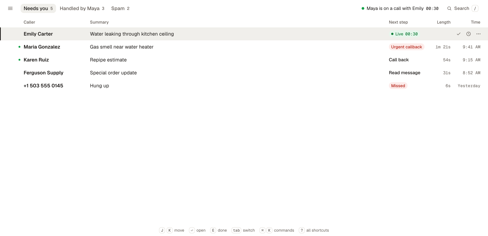

# Linedesk

**The open-source AI receptionist for businesses.** It answers every call, books the appointment and hands over to a person when needed, and you own the code and the data. Every call lands in a fast, keyboard-first inbox.

[Website](https://linedesk.ai) · [Self-hosting](#self-hosting) · [Roadmap](ROADMAP.md) · [Contributing](CONTRIBUTING.md) · [License](LICENSE)

> **Status: in development, the code is not public yet.** Linedesk already takes real phone calls in our development version. We will publish the source here under the AGPL-3.0 with the first public release. Watch or star the repository to get notified.



<sub>The inbox, shown in the design prototype with demo data.</sub>

## What it does

**On the phone**

- **Answers every call** with a natural voice, around the clock, and knows your business: services, prices, opening hours, FAQs, documents, or simply your website.
- **Books appointments** straight into Google Calendar or Microsoft 365, with your appointment types, working hours and buffers.
- **Hands over to a person.** Transfers go to named teammates under rules you write in plain language, each with a fallback. Urgent calls are flagged and can go to an on-call phone.
- **Recognises returning callers**, greets them by name and knows their last calls and upcoming bookings.
- **Takes details reliably:** names, numbers, addresses, emails and dates are confirmed step by step, with keypad input where it helps.

**After the call**

- **One inbox for all calls:** summary, next steps, transcript and recording, built for working through quickly with the keyboard. Works offline and installs as an app.
- **Push notifications** for new calls, urgent ones first, on desktop and phone.
- **Contacts** with call history, CSV import, merging of duplicates and blocking of spam callers.
- **Team:** invite people, assign calls, see who is handling what.

**For developers**

- **API:** every change in the app is an action you can also call over HTTP, described in OpenAPI.
- **MCP server**, so AI tools such as Claude or ChatGPT can work with your calls and bookings.
- **Signed webhooks** for finished calls, new bookings and taken messages, e.g. into your CRM via Zapier or Make.

## Bring your own providers

Linedesk is not tied to one vendor. You use your own accounts and pay their list prices:

| | Supported |
| --- | --- |
| Phone carrier | Telnyx or Twilio |
| Speech, language and voice | Deepgram, any model via OpenRouter, ElevenLabs; set up in the admin area |
| Calendar | Google Calendar, Microsoft 365 |
| Sign-in | Email code, password, passkeys, Google, Microsoft or your own OpenID Connect |

## Self-hosting

> **Available with the first public release.** The commands below show how it will work; they need the source code, which is not published yet.

Linedesk runs as one Docker Compose project on your own server: the web app, the API, the voice agent and its voice server, the database and a web server with HTTPS. Calls, recordings and customer data never leave your machine except to the providers you choose.

**You need**

- A Linux server with Docker (Compose v2.24 or newer) and about 1.5 GB of free RAM; a small VPS is enough
- A domain pointing at it
- A phone number from Telnyx or Twilio, and API keys for the speech, language and voice providers

**Install**

```bash
git clone https://github.com/linedesk/linedesk.git && cd linedesk
cp .env.example .env    # set PUBLIC_URL and the secrets listed in the file
docker compose up -d --build
```

Then open your `PUBLIC_URL`, sign in as the instance admin and add your provider keys in the admin area. Sign-up is closed by default, so only people you invite get in.

**Running it**

- **HTTPS your way:** Linedesk's own web server gets a certificate for you, or it runs behind a reverse proxy you already have.
- **Updates without downtime:** `git pull && scripts/deploy.sh` switches over to the new version while calls in progress finish on the old one.
- **Fits on a small box:** every service has a memory and CPU limit; the whole stack uses about 1 GB at rest.
- **Your data stays put:** everything lives in Docker volumes inside the install, easy to back up with `pg_dump`.

The full guide (settings, ports and firewall, connecting your phone numbers, backup and restore) will be published here with the code.

## Open source and hosting

Linedesk is licensed under the [AGPL-3.0](LICENSE) and can be self-hosted with your own provider keys and no license key.

For businesses that do not want to run servers, we are building a hosted version; that is how we intend to fund the project. You can [join the waitlist](https://linedesk.ai). If we ever add paid-only features, they will live in a separate `ee/` folder under their own license.

## Get involved

Until the code is public, the most useful thing is to tell us about your use case: open a [feature request](../../issues/new?template=feature_request.yml) and describe how calls work in your business today.

For anything else, write to [hello@linedesk.ai](mailto:hello@linedesk.ai).

## License

[AGPL-3.0](LICENSE). "Linedesk" and the Linedesk logo are trademarks of Sauerbier & Gutberlet GmbH; see [TRADEMARK.md](TRADEMARK.md).
