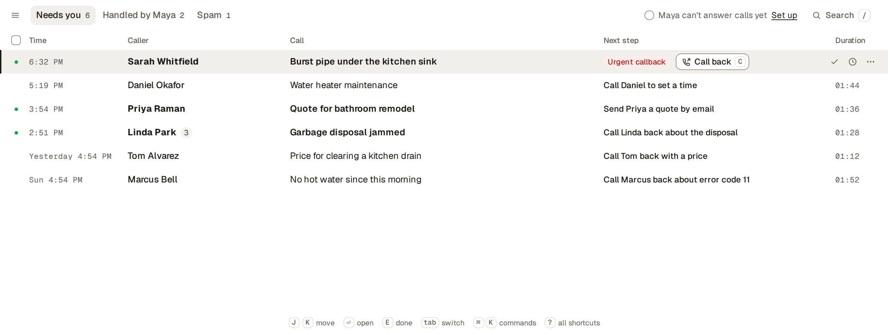

<p align="center">
  <a href="https://linedesk.ai">
    <picture>
      <source media="(prefers-color-scheme: dark)" srcset="brand/linedesk-logo-reversed.svg">
      
    </picture>
  </a>
</p>

<h3 align="center">The open-source AI receptionist for businesses</h3>

<p align="center">
  Answers every call, books the appointment and hands over to a person when needed.<br>
  You own the code and the data. Every call lands in a fast, keyboard-first inbox.
</p>

<p align="center">
  <a href="LICENSE"></a>
  <a href="https://registry.modelcontextprotocol.io/v0/servers?search=ai.linedesk"></a>
</p>

<p align="center">
  <a href="https://linedesk.ai"><b>Website</b></a> ·
  <a href="docs/README.md"><b>Docs</b></a> ·
  <a href="docs/hosting.md"><b>Self-hosting</b></a> ·
  <a href="CONTRIBUTING.md"><b>Contributing</b></a> ·
  <a href="ROADMAP.md"><b>Roadmap</b></a> ·
  <a href="mailto:hello@linedesk.ai"><b>Contact</b></a>
</p>

**Set it up with your AI agent.** Paste this into Claude Code, Codex or any coding agent with a shell:

```text
Please set up Linedesk for me: linedesk.ai/self-host.md
```

Or run the install script yourself on a new Ubuntu or Debian server ([self-hosting guide](docs/hosting.md)):

```sh
curl -fsSL https://raw.githubusercontent.com/linedesk/linedesk/HEAD/scripts/install.sh | sudo sh
```

Linedesk picks up the phone for a business: a natural-sounding assistant that knows the business, books appointments into its calendar, takes messages and puts urgent callers through to the right person. Afterwards every call is in one inbox with a summary, next steps, the transcript and the recording. Run it on your own server with your own provider accounts, or use Linedesk Cloud.



<sub>The inbox, shown in the design prototype with demo data.</sub>

## What it does

**On the phone**

- **Answers every call** with a natural voice, around the clock, and knows your business: services, prices, opening hours, FAQs, documents, or simply your website.
- **Books appointments** straight into your calendar, with your appointment types, working hours and buffers.
- **Hands over to a person.** Transfers go to named teammates under rules you write in plain language, each with a fallback. Urgent calls are flagged and can go to an on-call phone.
- **Recognises returning callers**, greets them by name and knows their last calls and upcoming bookings.
- **Takes details reliably:** names, numbers, addresses, emails and dates are confirmed step by step, with keypad input where it helps.
- **Speaks the caller's language:** the assistant can answer in many languages, and the app is translated into six.

**After the call**

- **One inbox for all calls:** summary, next steps, transcript and recording, built for working through quickly with the keyboard. Works offline and installs as an app.
- **Push notifications and emails** for new calls, urgent ones first, on desktop and phone.
- **Contacts** with call history, CSV import, merging of duplicates and blocking of spam callers.
- **Team:** invite people, assign calls, see who is handling what. Agencies can run workspaces for their clients from one partner team.
- **Your business tools:** every finished call goes to HubSpot, Jobber or a Slack channel, or anywhere through Zapier.

**For developers**

- **API:** every change in the app is an action you can also call over HTTP, described in OpenAPI.
- **MCP server**, so AI tools such as Claude or ChatGPT can work with your calls and bookings, and an AI agent can set up a whole install.
- **Signed webhooks** for finished calls, new bookings and taken messages, plus a during-call lookup so the assistant can ask your own system.

## Bring your own providers

Linedesk is not tied to one vendor. You use your own accounts and pay their list prices; every provider is connected in the app (Server admin › Providers), with a connection test:

| | Supported |
| --- | --- |
| Phone carrier | Telnyx or Twilio; a business can also connect its own carrier account |
| Speech to text | AssemblyAI, Deepgram, ElevenLabs Scribe, OpenAI |
| Language model | OpenAI, OpenRouter (any model), Anthropic, Google Gemini, Groq, Mistral |
| Voice | ElevenLabs, Cartesia |
| Speech to speech (optional) | OpenAI Realtime, instead of the three stages above |
| Transcript after the call (optional) | OpenAI, Deepgram, AssemblyAI, ElevenLabs Scribe |
| Calendar | Google Calendar, Microsoft 365, iCloud and other CalDAV calendars, Calendly, Cal.com |
| Email | Any SMTP service, Amazon SES, Resend, Postmark, SendGrid, Brevo, Mailgun, Gmail |
| Sign-in | Email code, password, passkeys, Google, Microsoft, GitHub or your own OpenID Connect |
| Call recordings | Local disk or any S3-compatible bucket (AWS S3, Cloudflare R2, Hetzner, Backblaze B2, MinIO) |
| Billing your own customers (optional) | Stripe, with your own account and prices |

## Connect your AI tool (MCP)

Linedesk has a remote MCP server, so Claude, ChatGPT, Cursor and other MCP clients can work with your workspace: read
calls and their summaries, find contacts, see and change bookings, and change your assistant's settings.

- **Address:** `https://app.linedesk.ai/mcp` (Streamable HTTP). On your own install: `https://<your-address>/mcp`.
- **Sign-in:** OAuth 2.1. Add the address as a custom connector in your AI tool, sign in with your Linedesk account
  and pick the workspace. No API key to copy. The connector acts with your role in that workspace.
- **Adding it:** Claude in one link,
  [Add to Claude](https://claude.ai/customize/connectors?modal=add-custom-connector&connectorName=Linedesk&connectorUrl=https%3A%2F%2Fapp.linedesk.ai%2Fmcp)
  (confirm, then Connect; Claude Team or Enterprise: the owner adds it under
  [organization connectors](https://claude.ai/admin-settings/connectors?modal=add-custom-connector&connectorName=Linedesk&connectorUrl=https%3A%2F%2Fapp.linedesk.ai%2Fmcp)).
  ChatGPT cannot add one by itself: in [ChatGPT's plugins](https://chatgpt.com/plugins) click Add › Add custom MCP
  server, paste the address and choose OAuth. Cursor and VS Code install it in one click from Workspace settings ›
  Integrations › MCP; Claude Code, Codex and Gemini CLI with one command from there.
- **Tools:** every action of the app (the same registry the web app uses), plus `calls_list`, `calls_get`,
  `contacts_search`, `workspaces_list` and `api_get`. Each tool says whether it only reads or also changes data.
- **Listed in:** the [official MCP registry](https://registry.modelcontextprotocol.io/v0/servers?search=ai.linedesk) as `ai.linedesk/linedesk`.

## Languages

Linedesk speaks English, Español, Português, Français, Deutsch and 日本語. Translations are made by AI and improved by people. See a bad translation? Fix it in a pull request or open a [Translation improvement](https://github.com/linedesk/linedesk/issues/new?template=translation_improvement.yml) issue. Missing your language? [Ask for it](https://github.com/linedesk/linedesk/issues/new?template=language_request.yml). How it works: [docs/translations.md](docs/translations.md).

## Quick start

**Linedesk Cloud:** sign up at [linedesk.ai](https://linedesk.ai) and we run it for you.

**Self-hosted:** on a new Ubuntu or Debian server, one command installs Docker, the code, the settings with random secrets and HTTPS, and ends with the address and a one-time setup code. [`scripts/install.sh`](scripts/install.sh) is short; read it before you pipe it into a shell.

```sh
curl -fsSL https://raw.githubusercontent.com/linedesk/linedesk/HEAD/scripts/install.sh | sudo sh
```

Or by hand on any machine with Docker (Compose v2.24 or newer) and about 2 GB of free RAM:

```sh
git clone https://github.com/linedesk/linedesk.git && cd linedesk
scripts/setup.sh                 # makes .env with a random value for every secret
docker compose up -d --build
docker compose logs api | grep -A3 "setup code"
```

Open `PUBLIC_URL` (default `http://localhost`), enter the setup code and connect your providers in the app. Real phone calls need a server with a public IP; on your own computer everything else works, including test calls in the browser.

- Where to get a server, which size, the one-command install and your own domain: [docs/hosting.md](docs/hosting.md)
- Settings, HTTPS and reverse proxies, ports and firewall, memory, updates, backups and restore: [docs/self-hosting.md](docs/self-hosting.md)
- Before you take real calls: [your responsibilities when you run Linedesk](docs/operator-responsibilities.md) (recording consent, AI disclosure, callers' data, emergencies)

## Development quickstart

Requirements: Node 22.18 or newer (it runs the TypeScript files directly), pnpm 10, Docker.

```sh
pnpm install
scripts/setup.sh                                # makes .env with a random value for every secret, SECRETS_KEY included
pnpm db:up && pnpm db:migrate && pnpm db:seed   # Postgres + Electric; the seed prints the demo sign-in
pnpm dev                                        # API on 3100, web app on http://localhost:5173
pnpm --filter @linedesk/agent simulate          # a simulated call lands in the inbox, no provider keys needed
```

Use `scripts/setup.sh`, not a plain `cp .env.example .env`: the copy leaves `SECRETS_KEY` empty, and then nothing can be connected under Server admin › Providers (or set it yourself: `openssl rand -base64 32`).

The demo sign-in uses a password. Without the seed, the API prints a setup code to its log (the terminal running `pnpm dev`); the sign-in page asks for it and makes you the first admin. Email codes go nowhere until email is connected (Server admin › Providers); for local development uncomment `EMAIL_TO_LOG=true` in `.env` to print them to the API log. There is no open sign-up: people get an account through an invitation or a server admin.

The simulator dials the install's only Linedesk number (the seed's demo number). With none or several, pass the number: `pnpm --filter @linedesk/agent simulate --to +1…` (or set `SIM_TO_NUMBER` in `.env`). Simulated calls show in the inbox like real ones but never count as a real call in setup progress or usage.

Your own test data in every local stack and worktree: `pnpm db:seed -- --user <your email>` once, then `pnpm dev:snapshot`; a new local database starts from that snapshot. More in [CONTRIBUTING.md](CONTRIBUTING.md).

## What's here

| Path | What it is |
| --- | --- |
| [`apps/api`](apps/api) | API server (Hono): sign-in, the action registry (the one write path), read sync, MCP |
| [`apps/web`](apps/web) | The inbox: a local-first, keyboard-first web app (installable) |
| [`apps/agent`](apps/agent) | The voice assistant (LiveKit Agents) and a call simulator |
| [`packages/`](packages) | Database schema, actions, sync, telephony, calendar, billing and CRM adapters, translations |
| [`integrations/`](integrations) | The HubSpot, Jobber, Slack and Zapier apps |
| [`prototypes/inbox-html/`](prototypes/inbox-html) | The reference design as a single-file clickable prototype. Run: `cd prototypes/inbox-html && python3 -m http.server 4173` |
| [`docs/`](docs/README.md) | Architecture, API, self-hosting, design principles and more |

Demo data is fictional (Brightwater Plumbing & Heating, Portland; assistant "Maya").

## Get involved

- **Contribute:** read [CONTRIBUTING.md](CONTRIBUTING.md) and [CLAUDE.md](CLAUDE.md) (the conventions, for people and AI agents alike). Bigger changes start with an issue.
- **Questions and help:** [SUPPORT.md](SUPPORT.md).
- **Security:** never in a public issue; see [SECURITY.md](SECURITY.md).
- **What comes next:** [ROADMAP.md](ROADMAP.md).
- Everyone in the project follows the [Code of Conduct](CODE_OF_CONDUCT.md).

## License

Copyright © 2026 Sauerbier & Gutberlet GmbH and contributors. Licensed under the [MIT license](LICENSE); third-party notices in [NOTICE](NOTICE).

Exception: the audio files in `apps/api/assets/voice-previews/` are not covered by the MIT license; see the
[README in that folder](apps/api/assets/voice-previews/README.md).

"Linedesk" and the Linedesk logo are trademarks of Sauerbier & Gutberlet GmbH; see [TRADEMARK.md](TRADEMARK.md). [Legal notice](https://linedesk.ai/legal).
